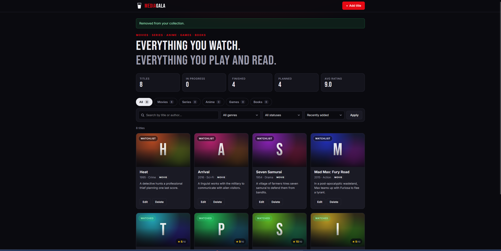
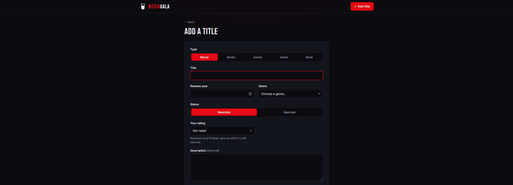
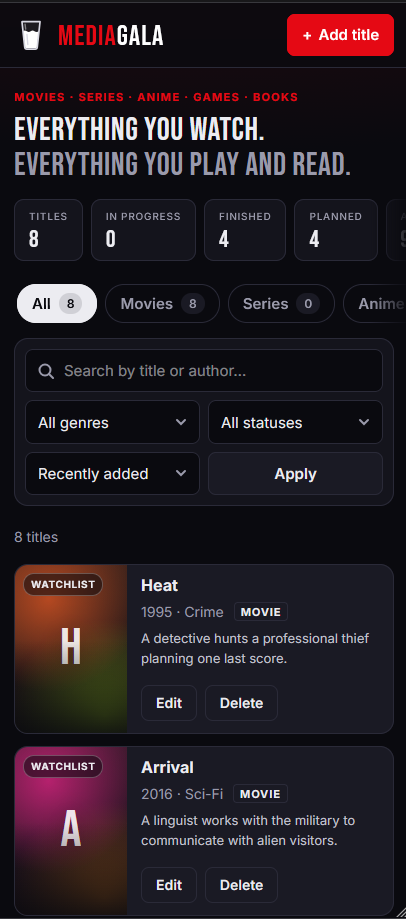

# 🥛 MediaGala

**MediaGala** is one personal tracker for **movies, TV series, anime, video games and books**, so you don't need a separate app for each. You can log, rate and organize everything you watch, play and read. It remembers which episode you stopped at, how far you got in each game and which page you're on. The look is inspired by a milk carton, with a light and a dark theme.
It's built with **FastAPI**, **SQLAlchemy 2.0**, **SQLite** and **Jinja2**. It renders on the server, needs no JavaScript framework, and doesn't use paid APIs or API keys.



---

##  Features

- **Movies, series, anime, games and books in one collection:** switch between *All*, *Movies*, *Series*, *Anime*, *Games* and *Books* tabs
- **Add, edit and delete titles** with title, release year, genre, description and a personal rating (1–10)
- **Statuses that fit each type:**
  - Movies: *Watchlist* or *Watched*.
  - Series and anime: *Watchlist*, *Watching*, *Watched* or *Dropped*.
  - Games: *Backlog*, *Playing*, *Completed* or *Dropped*.
  - Books: *To read*, *Reading*, *Read* or *Dropped*.
  - Dropped titles get a red frame.
- **Game tracking:** record how far you got (*Story*, *Story + DLC* or *100% completion*) and how many hours you played.
- **Reading tracking for books:**
  - Record the author and the total number of pages.
  - Update the page you're on; a progress bar shows how far along you are.
  - Reaching the last page asks you to rate the book.
- **Episode tracking for series and anime:**
  - Set the number of seasons and the episodes in each one. Seasons can have different lengths.
  - Tick episodes off on the series page; clicking an episode marks it and everything before it as watched.
  - Use the quick "✓ next episode" button on each card.
  - Follow your progress with a progress bar and an "Up next" episode.
  - After the final episode, the app asks you to rate the series and marks it as watched.
- **Search** by title or author (case-insensitive)
- **Filter** by type, genre and watch status
- **Sort** by title, release year or rating (ascending/descending), or by date added
- **Stats:** total titles, in progress, finished, planned and average rating
- **Persistent storage** in a local SQLite database
- **Server-side validation** with field-level error messages
- **Responsive** layout for desktop, tablet and mobile
- **Light and dark themes:**
  - The app follows your system setting by default.
  - The ☀️/🌙 button in the header switches theme, and the app remembers your choice.
  - There's no flash of the wrong theme while a page loads.
- **Custom images:** upload your own JPG, PNG or WebP image for any title, then replace or remove it later
- **Generated "posters":** titles without an image get a unique gradient card, so no external images are needed

##  Tech Stack

| Layer      | Technology                         |
|------------|------------------------------------|
| Language   | Python 3.13                        |
| Web        | FastAPI · Uvicorn                  |
| Database   | SQLite · SQLAlchemy 2.0 (ORM)      |
| Validation | Pydantic v2                        |
| Frontend   | Jinja2 templates · HTML5 · CSS3    |

##  Project Structure

```
mediagala/
├── app/
│   ├── main.py              # App factory, static files, error handlers
│   ├── catalog.py           # Kinds, statuses, genres: what each kind supports
│   ├── database.py          # Engine, session factory, get_db, lightweight migrations
│   ├── models.py            # SQLAlchemy models (Title, Season) + episode-progress logic
│   ├── schemas.py           # Pydantic validation for form input
│   ├── crud.py              # Data access: queries, filtering, sorting, stats
│   ├── posters.py           # Image upload validation and storage
│   ├── seed.py              # Optional sample data
│   ├── templating.py        # Shared Jinja2 environment
│   ├── routers/
│   │   └── titles.py        # HTML routes (list, detail, create, edit, delete, episodes)
│   ├── templates/           # Jinja2 templates
│   │   ├── base.html
│   │   ├── index.html
│   │   ├── title_detail.html
│   │   ├── title_form.html
│   │   ├── error.html
│   │   └── partials/        # title_card.html, poster.html
│   └── static/
│       ├── css/style.css
│       ├── js/title-form.js # Adapts the form to the chosen kind
│       └── favicon.svg
├── docs/screenshots/        # README images
├── data/                    # SQLite database + uploaded images (created at runtime, git-ignored)
├── run.bat                  # Windows one-click launcher
├── run.py                   # Starts the server and opens the browser
├── requirements.txt
└── README.md
```

Each layer has one job. **Routes** handle HTTP, **schemas** validate input, **crud** talks to the database, and **templates** render the UI.

### Data model

Movies, series and games share one `titles` table, so search, filters, sorting and images work the same for every kind. A series also has a list of `seasons`, each with its number of episodes, in a one-to-many relationship with cascade delete. Games add a completion level and hours played.

Everything that differs per kind lives in one place, [`catalog.py`](app/catalog.py): allowed statuses and their labels ("Watched" vs "Completed"), genres, and whether the kind has episodes. The validation, the templates and the form's JavaScript all read from it. Anime was added as a single configuration entry that reuses the series behaviour (`has_episodes=True`). Books turn on page tracking (`has_pages=True`) and have their own statuses ("To read", "Reading", "Read"), genres and year label.

Episodes are watched in order, so progress is stored as a single bookmark: the last watched season and episode. Every episode up to that point counts as watched. This keeps the schema small and makes "up next" and progress percentage simple calculations.

##  Getting Started

### Prerequisites

- Python 3.13 (3.11+ should work)
- Git

### Quick start (Windows)

Download or clone the project and **double-click `run.bat`**.
The first run creates a virtual environment and installs the dependencies. After that, the app starts and opens in your browser.
To stop it, press `Ctrl+C` in the window or close the window.

### Manual installation

```bash
git clone https://github.com/ramoneus/mediagala.git
cd mediagala

# Create and activate a virtual environment
python -m venv .venv

# Windows (PowerShell)
.venv\Scripts\Activate.ps1
# macOS / Linux
source .venv/bin/activate

pip install -r requirements.txt
```

### Run

```bash
python run.py                       # starts the server and opens the browser
# or, for development with auto-reload:
uvicorn app.main:app --reload
```

Open **http://127.0.0.1:8000** in your browser.
The database (`data/movies.db`) is created automatically on first start.

### Optional: load sample data

```bash
python -m app.seed
```

This adds example movies, series and games, but only if the database is empty.

##  Validation & Safety

- All form input is validated with **Pydantic** before it reaches the database. Validation covers required fields, length limits, year range (1888 to the current year + 5), known genres only, and ratings from 1 to 10.
- **Business rules:**
  - Finished titles must have a rating, and planned titles have their rating cleared.
  - Each kind only accepts its own statuses and genres. For example, a movie can't be *Dropped* and a game can't be *Sci-Fi*.
  - A completed game must say how far it was played.
  - Episode progress must exist in the series' seasons.
  - Marking a series as watched sets its progress to the final episode.
- Older databases are migrated automatically on start-up. The table is renamed and the new columns are added, so existing data is kept.
- If a form is invalid, the page renders again with the user's input kept and an error message on each invalid field (HTTP 422).
- **Post/Redirect/Get:** every create, update and delete ends in a `303` redirect, so refreshing the page never submits a form twice.
- **No SQL injection:** all queries use SQLAlchemy parameter binding. Sort options come from a whitelist, and `LIKE` wildcards in searches are escaped.
- **No XSS:** Jinja2 autoescaping is enabled, and flash messages are chosen by key, never taken from user text.
- A database `CHECK` constraint enforces the rating range a second time.
- **Safe image uploads:**
  - The file type is detected from the file's actual bytes, not from its name or the browser's claim.
  - Only JPG, PNG and WebP are accepted. SVG is rejected because it can contain scripts.
  - The size limit is 5 MB.
  - Files are stored under random names, so a user's file name never touches the file system.
  - When a title's image is replaced or the title is deleted, the old file is removed.
- **No open redirects:** the "next episode" button only redirects back to paths inside the app.
- Custom error pages for 404, 400 and 500 responses. Unexpected errors are logged and never shown to the user.

##  Screenshots

| Home | Add / Edit | Mobile |
|------|------------|--------|
|  |  |  |

## 🗺 Possible Improvements

- Automated tests with `pytest` and FastAPI's `TestClient`
- Pagination for large collections
- Automatic poster lookup via a free API such as TMDB
- User accounts, so several people can keep their own lists
- Database migrations with Alembic
- CSRF protection if the app is ever deployed publicly

## 📄 License

[MIT](LICENSE). Feel free to use this project for learning.
